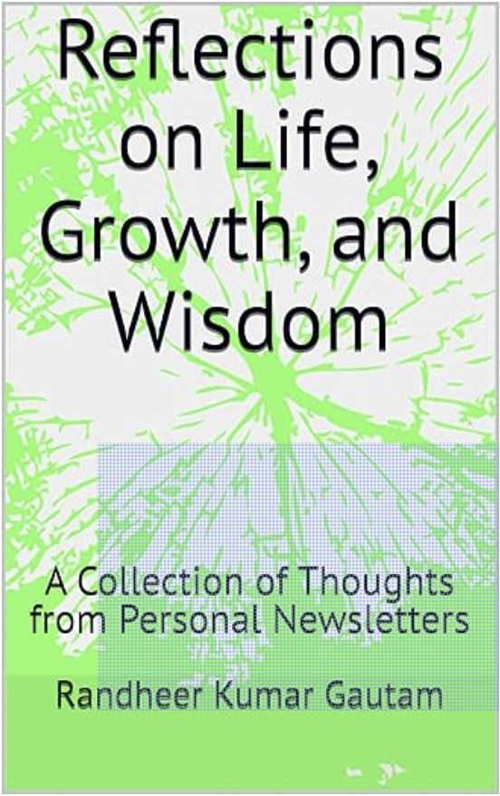

<section class="hero">
  
Digital garden · Bengaluru

  <h1>Hi, I'm Randheer 🪴</h1>
  
A software engineer's living notes on backend systems, Django, Go, Flutter, Docker, and the occasional book.

  
<a href="./now">What I'm up to now →</a><a href="https://musings.randheer.in/index.xml">Follow via RSS</a>

</section>

<section class="topic-grid" aria-label="Browse by topic">

<article class="topic-card">
  <h3><a href="./Django">Django</a></h3>
  
Internals, DRF, and patterns I rely on.

</article>

<article class="topic-card">
  <h3><a href="./Golang">Go</a></h3>
  
Idioms, nuances, and system design in Go.

</article>

<article class="topic-card">
  <h3><a href="./backend">Backend & Infra</a></h3>
  
Docker, Redis, and auth with JWTs.

</article>

<article class="topic-card">
  <h3><a href="./typescript">JavaScript & TypeScript</a></h3>
  
Async patterns and project tooling.

</article>

<article class="topic-card">
  <h3><a href="./Flutter">Flutter</a></h3>
  
Cross-platform mobile notes.

</article>

<article class="topic-card">
  <h3><a href="./Python">Python</a></h3>
  
Small gotchas worth remembering.

</article>

</section>

<section class="book-feature" aria-label="My book">
  
  

    
My book · free to read

    <h2><a href="./book/reflections-on-life-growth-and-wisdom">Reflections on Life, Growth, and Wisdom</a></h2>
    
Stoicism, habits, investing, and mental models — 18 chapters distilled from years of personal newsletters.

    
<a class="btn" href="./book/reflections-on-life-growth-and-wisdom">Read online</a><a class="btn btn-ghost" href="./book/reflections-on-life-growth-and-wisdom.pdf">Download PDF</a>

  

</section>
